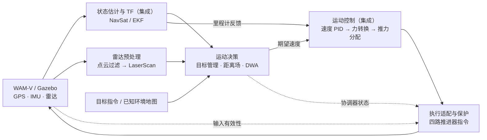

# std_usv 无人船软件控制系统

`std_usv` 面向 WAM-V 无人船，组织传感器输入、状态估计、环境感知、运动决策、闭环控制和推进器执行，提供无人船软件控制系统的运行入口与配套工具。

当前实现基于 **ROS1 Noetic + Gazebo、单艘四推进器 WAM-V**。任务层已实现点到点自主航行与避障，定位、感知处理、运动控制和执行保护构成其完整闭环。

## 已实现功能

| 功能 | 当前实现 | 实现方式 |
|---|---|---|
| 系统启动 | 完整仿真启动，或接入已运行的无人船仿真；支持地图、初始位姿和目标配置 | 本包编排；仿真环境与船模型由 `ocean_simulation_gazebo` 等依赖提供 |
| 状态估计 | GPS 位置与 IMU 航向、角速度融合，输出平面里程计和 TF | 集成 `robot_localization`、机器人状态发布器 |
| 环境感知 | 雷达点云变换、自回波与高度过滤、LaserScan 转换、临时障碍观测 | 本包处理与观测层，集成 `pointcloud_to_laserscan` |
| 运动决策 | 启动目标与途中换目标、路径搜索、目标距离场、局部避障、到达判断及停滞恢复 | 本包目标管理、A* 和 DWA |
| 运动控制 | 速度反馈 PID、期望加速度到力／力矩转换、四推进器推力分配 | 集成 `cascaded_pid_controller`、`wamv_thruster_manager` |
| 执行保护 | 非线性推力换算、同比限幅、输入无效或超时归零、重新启用前重置 PID | 本包输出适配器 |
| 仿真与验证 | 地图及艇体参数生成、可选浮标运动、码头示意框可见性修正、RViz 显示及回归检查 | 本包工具、插件、配置和测试 |

当前控制闭环使用 GPS、IMU 和雷达。相机、声学传感器以及推进器的仿真模型和插件由依赖包提供；实船硬件接入需要另行适配。

## 程序框架



本包负责控制链的组织、运动决策及最终输出保护。定位、PID 和推力分配通过依赖包接入；地图生成、动态浮标和可见性修正属于仿真支持。

## 代码文件职责

| 文件 | 功能 |
|---|---|
| [navigation_coordinator_node.cpp](src/navigation_coordinator_node.cpp)、[avoidance_dwa.cpp](src/avoidance_dwa.cpp) | 程序入口；输入与 TF 检查、目标处理、路由更新、DWA、到达与恢复 |
| [avoidance_astar.cpp](src/avoidance_astar.cpp) | 栅格转换、障碍膨胀、A* 搜索、完整目标最短距离场 |
| [navigation_goal_relay.cpp](src/navigation_goal_relay.cpp) | 发布一次启动目标，锁存并原样转发后续目标请求 |
| [navigation_cloud_filter.py](scripts/navigation_cloud_filter.py) | 将雷达点云变换到艇体坐标系，过滤自身回波和高度范围 |
| [thruster_output_adapter.py](scripts/thruster_output_adapter.py) | 推力映射、四路限幅、数据与状态检查、PID 重置、最终指令发布 |
| [generate_navigation_maps.py](scripts/generate_navigation_maps.py)、[navigation_map_publisher.py](scripts/navigation_map_publisher.py) | 离线生成已知地图与艇体参数；校验资源并发布占据栅格 |
| [navigation_dynamic_buoys.py](scripts/navigation_dynamic_buoys.py) | 按仿真时间驱动指定地图的浮标，默认关闭 |
| [navigation_visual_filter_node.cpp](src/navigation_visual_filter_node.cpp)、[navigation_sensor_visibility.cpp](src/navigation_sensor_visibility.cpp) | 向指定码头示意框附加可见性插件，保留 GUI 显示并排除传感器假回波 |
| [include/path_planning/](include/path_planning/) | 栅格、搜索、DWA、观测层及协调器的类型与接口声明 |

`config/` 保存定位、运动限制、控制器、艇体及显示参数；`maps/` 保存两套已知环境栅格及来源清单；`test/` 包含算法、接口、执行保护和仿真验收检查。

## 运行入口

加载工作区环境后，启动完整无人船仿真与软件控制链：

```bash
roslaunch std_usv demo_astar_dwa.launch
```

已经运行匹配的无人船仿真时，启动定位、感知、决策和控制链：

```bash
roslaunch std_usv astar_dwa_mix.launch
```

当前两份入口均包含自主航行功能。目标接口为 `/wamv/navigation/goal`，期望速度为 `/wamv/cmd_vel`；`/wamv/navigation/status` 表示协调器状态，最终执行指令由输出适配器独占发布。

具体启动、配置和接口见 [使用说明](docs/navigation.md)，已执行的测试及验证范围见 [验证记录](docs/validation.md)。
