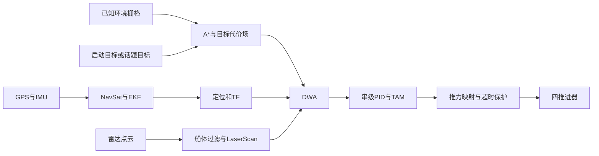

# WAM-V A*＋DWA 导航

本包将归档工程中的 A*＋DWA 点到点规划接入当前四推进器 WAM-V。全局目标代价场引导 DWA，A* 路径供显示与诊断；局部规划不沿路径逐点跟踪。BINN 覆盖规划、APF、LOS、无人机及归档工作空间不参与默认启动。

## 构建与依赖

在当前 catkin 工作区根目录执行：

```bash
source devel/setup.bash
catkin_make --pkg std_usv -j2 -l2
source devel/setup.bash
catkin_make run_tests_std_usv -j2 -l2
catkin_test_results build/test_results/std_usv
```

环境需已叠加依赖工作区，能找到 `wamv_gazebo`、`cascaded_pid_controller`、`wamv_thruster_manager` 和仿真资源。运行依赖已声明于 package.xml。Noetic 的 `pointcloud_to_laserscan`、Hector／Velodyne 插件和 `robot_localization` 已完成安装检查；不需要移植归档中的这些包。原本地传感器动态库与 apt 版本一致，保留现有副本即可。

只安装本包时，先构建，再执行：

```bash
cmake --install build/robots/sci_usv/std_usv
touch install/.catkin
export CMAKE_PREFIX_PATH="$(pwd)/install:$CMAKE_PREFIX_PATH"
export ROS_PACKAGE_PATH="$(pwd)/install/share:$ROS_PACKAGE_PATH"
export LD_LIBRARY_PATH="$(pwd)/install/lib:$LD_LIBRARY_PATH"
```

该命令使用工作区配置的安装前缀（默认 `install`，以上环境命令对应此前缀），安装当前运行所需的程序、配置、地图和文档。完整安装空间的 setup 文件由工作区顶层安装流程生成；上述空标记和三个路径用于独立验证单包安装。验证时确认 `roslib.packages.find_node('std_usv', 'navigation_coordinator_node')` 返回 `install/lib/std_usv`，避免误用devel中的节点。

## 启动与切换地图

完整入口同时启动 Gazebo、唯一 `wamv` 和导航：

```bash
roslaunch std_usv demo_astar_dwa.launch
```

无 Gazebo 界面和 RViz：

```bash
roslaunch std_usv demo_astar_dwa.launch gui:=false rviz:=false
```

在支持渲染的环境运行；GPU 雷达和相机即使关闭 GUI 也需要可用的 OpenGL。该入口不加载无人机、PX4 或 MAVROS。

五张地图为 `map1-1.world`、`map1-2.world`、`map1-3.world`、`map2-1.world`、`map2-2.world`：

```bash
roslaunch std_usv demo_astar_dwa.launch \
  world:="$(rospack find ocean_simulation_gazebo)/worlds/usv_path_planning/map2-1.world"
```

若已经运行现有 `demo_usv.launch`，只启动导航，避免重复生成船：

```bash
roslaunch std_usv astar_dwa_mix.launch \
  world:="$(rospack find ocean_simulation_gazebo)/worlds/usv_path_planning/map1-3.world"
```

独立导航入口的 `world` 必须与已经加载的地图一致；自定义放船位置时同步传入 `usv_x / usv_y / usv_yaw`，作为定位初值。GPS 仍负责修正该初值。六自由度放置参数由完整 Demo 传给现有生成模块；平面定位使用 x、y、yaw。

## 参数与新目标

| 参数 | 默认值 | 含义 |
|---|---|---|
| world | map1-3.world | 当前五张地图之一的完整路径 |
| gui / paused / verbose | true / false / false | 现有 Gazebo 参数 |
| usv_x / usv_y / usv_z | -570 / 167 / 0.1 | 世界坐标，米 |
| usv_roll / usv_pitch / usv_yaw | 0 / 0 / 1 | 弧度，完整 Demo 提供六个参数 |
| use_initial_goal | true | 是否发布一次启动目标 |
| goal_frame | map | 目标参考坐标系 |
| goal_x / goal_y / goal_yaw | -500 / 232 / 0 | 米、弧度 |
| hz | 10 | DWA 控制周期，Hz |
| rviz | true | 显示地图、艇体、目标和轨迹 |
| dynamic_obstacles / buoy_speed | false / 0.7 | 是否驱动对应浮标及其速度，m/s |
| map_yaml | 空 | 自定义地图配置；显式提供时由使用者保证世界与地图一致 |

默认目标与原工程 `(70,65)` 相对于 `(-570,167)` 的位移一致。启动目标仅发布一次。新的 `/wamv/navigation/goal`（`geometry_msgs/PoseStamped`）会替换当前任务，重新生成目标代价场；RViz 的 **2D Nav Goal** 也发布此话题。

```bash
rostopic pub -1 /wamv/navigation/goal geometry_msgs/PoseStamped \
  '{header: {frame_id: map}, pose: {position: {x: -500.0, y: 232.0, z: 0.0}, orientation: {w: 1.0}}}'
```

发布其他航向时使用有效四元数（z=sin(yaw/2)，w=cos(yaw/2)）。缺少坐标系、无效四元数、越界或不可达目标将停止旧任务，而非继续前往旧目标。关闭默认目标可使用 `use_initial_goal:=false`。

合法目标若使用其他坐标系而TF尚未就绪，会先停车并等待转换；TF到达后只转换一次并固定在 `map`，不需要重新发布。新的合法目标或无效目标都会取消旧的待转换目标。

`/wamv/navigation/goal_relay` 将外部目标原样转发到锁存的 `/wamv/navigation/goal_request`，并负责发布一次启动目标。该话题保存目标请求，坐标系和四元数保持请求内容；校验和地图坐标转换由 `/wamv/navigation/coordinator` 完成。

状态话题 `/wamv/navigation/status` 类型为 `std_msgs/String`：

| 状态 | 行为 |
|---|---|
| waiting_for_inputs | 等待地图、定位、TF、雷达或模型参数，输出零 |
| planning | 更新目标代价场和搜索路径，输出零 |
| navigating | DWA 导航 |
| aligning | 到达附近调整航向、等待低速稳定，或静止时安全调整朝向 |
| goal_reached | 位置≤1m、航向≤0.15rad，低速保持2秒后完成 |
| blocked | 当前无可行路线或轨迹，输出零并等待恢复 |
| invalid_goal | 新目标无效，输出零，等待下一目标 |

`PREFERRED_VELOCITY=0.8` 提供优选速度采样；默认速度代价权重为0，终端代价仍可能选择最高允许的1m/s。需要速度偏好时调节 `SPEED_COST_GAIN`，并重新验证效果。运动限制、预测时间、碰撞余量、膨胀半径和权重统一见 `config/dwa_param.yaml`。

`GOAL_BEARING_COST_GAIN=0.0` 衡量预测轨迹末端朝向与指向目标位置方向的偏角，默认关闭；`GOAL_YAW_TOLERANCE=0.15` 则是到达终点时允许的最终目标航向误差，单位rad。算法参数加载在 `/wamv/navigation/coordinator` 下。使用自定义参数文件时，可通过导航入口的 `dwa_param:=/absolute/path/dwa.yaml` 传入完整DWA配置。

完成前的低速判定使用完整平面速度 `hypot(vx,vy)`，默认不超过0.05m/s，偏航角速度不超过0.05rad/s，并持续2秒；分别由 `SETTLE_VELOCITY_THRESHOLD`、`SETTLE_YAWRATE_THRESHOLD` 和 `SETTLE_SECONDS` 配置。该条件比独立验收的0.1上限更严格，用于留出停止推力后的动力学瞬态余量。

## 命名迁移（2026-11-06）

本轮一次性切换到以下名称。旧参数不再读取，旧程序、话题和C++类型均不提供兼容别名；两个launch入口及原命令行参数保持现状。自定义YAML、节点管理脚本和录包配置应按表更新。

| 原名称 | 新名称 |
|---|---|
| `TURN_DIRECTION_THRESHOLD` / `yaw_threshold_` | `GOAL_YAW_TOLERANCE` / `goal_yaw_tolerance_` |
| `YAW_COST_GAIN` / `yaw_gain` | `GOAL_BEARING_COST_GAIN` / `goal_bearing_gain` |
| `TARGET_VELOCITY` / `target_velocity` | `PREFERRED_VELOCITY` / `preferred_velocity` |
| 程序 `local_goal_pub` / 类 `GoalPublisher` | 程序 `navigation_goal_relay` / 类 `NavigationGoalRelay` |
| 节点 `/local_goal_pub` | `/wamv/navigation/goal_relay`，启动目标私有参数随节点迁移 |
| 内部话题 `/local_goal` | `/wamv/navigation/goal_request`，仍为锁存的 `geometry_msgs/PoseStamped` |
| 类 `DWAPlanner` | `NavigationCoordinator` |
| 程序 `avoidance_dwa_node` | `navigation_coordinator_node` |
| 节点 `/local_planner/avoidance_dwa_node` | `/wamv/navigation/coordinator`，算法私有参数及轨迹话题随节点迁移 |

外部目标 `/wamv/navigation/goal`、控制 `/wamv/cmd_vel`、状态 `/wamv/navigation/status`、传感器与推进器接口保留。算法公式、默认数值、恢复逻辑和控制保护均保留。

## 文件精简与配置迁移（2026-11-06）

删除未启用的BINN源码及头文件、UTM转换头文件、四份旧动态障碍脚本、预设里程计演示和LOS配置。当前动态浮标继续由 `navigation_dynamic_buoys.py` 统一管理，全部自动与手动验收脚本保留。

传感器及控制的两个短launch已合入 `astar_dwa_mix.launch`，删除原 `launch/core` 下的两个入口，不提供占位文件。完整仿真与独立导航的两个顶层入口保留，节点、重映射及参数作用域保持原样。

`robot_param.yaml` 已并入 `dwa_param.yaml`，独立导航入口移除 `robot_param` 参数。自定义机器人限值与DWA权重统一写入同一个完整配置，通过以下方式加载：

```bash
roslaunch std_usv astar_dwa_mix.launch rviz:=false dwa_param:=/absolute/path/dwa.yaml
```

生成的 `wamv_inertial.yaml` 已并入 `wamv_model.yaml`。新文件的 `navigation.model` 保存原模型数据，`pid` 保存控制器质量和惯性；入口将整个文件仅加载一次到 `/wamv`。原 `/wamv/navigation/model/...` 与 `/wamv/pid/...` 参数路径和数值保留。直接读取YAML的维护脚本应使用 `settings['navigation']['model']['footprint']` 取得轮廓。

文件净减少13个：生产C++／头文件／Python由21个减至13个，launch由4个减至2个，配置由10个减至7个。旧文件和旧配置入口均不提供兼容别名。

## 数据与控制链路



TF 为 `world → map → wamv/odom → wamv/base_link → 传感器`。固定地理原点为纬度30.3143、经度120.338、ENU朝向0；GPS杆臂由安装TF补偿。EKF融合GPS位置与IMU航向／角速度，输出 `/wamv/robot_localization/odometry/filtered`。GPS速度消息保留，不直接作为艇体速度融合。

现有 SDF 负责生成实体；URDF 只为 robot_state_publisher 与 RViz 提供运动学。不会生成第二艘船，也不订阅 Gazebo 真值进行导航。

原始雷达话题保持 `/wamv/sensors/lidars/lidar_wamv/points`；导航过滤点云为 `/wamv/navigation/points_filtered`，转换扫描为 `/scan`（10Hz）。过滤先在船体坐标系移除实体内回波，保留高度0.05～2m、距离0.2～30m的数据。原始相机、GPS、IMU、pinger接口不变。

当前码头模型的 `bay_visualization::bay_box` 和 `bay_box_exterior` 是没有碰撞体的停靠区域示意框，但默认会遮挡GPU雷达，造成假墙。导航入口的 `navigation_visual_filter_node` 仅针对当前世界中显式引用 `dock_2018_dynamic` 的已知码头，将本包的VisualPlugin附加到这两种示意框，设置为只在GUI显示。真实码头结构、未知障碍和船体继续正常参与渲染与碰撞；世界文件、第三方模型及原始传感器话题均保留。该节点只初始化Gazebo传输接口，按墙钟等待master、目标世界命名空间及其响应发布者就绪，再创建场景请求连接；暂停启动时同样可配置和退出，不依赖固定启动延时。

控制链保留 `/wamv/cmd_vel`。原分配器先输出到 `/wamv/navigation/raw_thrusters/*_thrust_cmd`，适配节点独占最终 `/wamv/thrusters/*_thrust_cmd`，并保持推进器相对转角为0以使用既有X布局。当前模型总质量314.285kg、基座偏航惯量约803.511kg·m²；参数由SDF生成，不修改物理模型。

适配器按现有GLF非线性映射反解推力，四路同比缩放后限制于[-1,1]。原插件归一化0存在约+0.0414N的拟合残余；正向分支存在间隙，小推力反解误差上界约0.58N，适配器选择最接近的可达值。停车仍按原接口发送归一化0，不修改第三方插件。

指令、定位、扫描或原始四路指令超过0.5秒未更新，GPS／IMU超过1秒未更新，或规划状态失效，最终输出归零。重新启用前通过现有动态配置服务清理PID，再等待一组完整新指令。活动导航／对齐期间的零速度目标允许PID施加制动力；到达、阻塞和其他非活动状态则直接输出归一化0。所有超时按仿真时间计算，暂停不会自动解除；重置仿真时间后重新等待数据。传感器允许最多0.05秒的轻微时间戳先到，以容忍消息与时钟回调顺序差异，更远的未来时间戳仍拒绝。

本包速度PID比例增益初值为4，线加速度和偏航角加速度饱和均为0.5，积分与微分关闭。DWA每周期只允许相对实测速率增加0.05，较低比例增益会使实际推力被水阻抵消，无法接近规划速度；调整控制参数时应同时检查这一动态窗口与实际运动响应。

## 地图生成与动态障碍物

`maps/map1.yaml` 与 `map2.yaml` 配套PGM，原点(-580,157)、范围120×120m、分辨率0.5m。岸线与码头来自现有碰撞几何，包含地图2新增码头；未知平台、堆叠障碍及浮标不预先加入栅格。局部碰撞采用艇体凸包加0.3m余量，全局膨胀默认2m。自定义地图需轴对齐，栅格原点yaw为0。

运行中将雷达实际观测到的未知障碍加入临时路由层，每秒至多更新一次目标代价场。观测默认5秒过期，接近已知障碍0.5m内的回波不重复加入；基础地图保持不变。这用于绕开地图2未知平台造成的局部最小值，并避免移动浮标永久封住路线。相关私有参数为 `OBSERVATION_TTL`、`OBSERVATION_REPLAN_INTERVAL`、`KNOWN_RETURN_TOLERANCE`、`STALL_TIMEOUT`。不会使用Gazebo真值更新地图。

默认速度及航向附加代价均为0，背向代价场下降方向时可能持续选择零速度。艇体与DWA输出均保持低速超过 `STALL_TIMEOUT=2` 秒后，规划器从当前终端代价场选取可通行的下降方向，检查完整转向过程的艇体轮廓和余量，再原地转向。接近该方向后恢复普通DWA；空间不足时停车并发布 `blocked`。这项恢复不使用A*路径跟踪，也不绕过碰撞检查。

```bash
rosrun std_usv generate_navigation_maps.py --check
rosrun std_usv generate_navigation_maps.py
```

第二条命令会重新生成地图、来源清单和模型惯性／轮廓配置，适用于源码空间维护。来源清单使用 package:// 路径和哈希；自动地图选择会检查世界已知布局、地理基准与依赖资源是否发生变化，防止静默使用过期地图。修改已知环境后应重新生成并验证。修改未知障碍的位置不会把其真值引入全局地图。

```bash
roslaunch std_usv demo_astar_dwa.launch dynamic_obstacles:=true buoy_speed:=0.7
```

map1-3启用浮标1、2，map2-1启用浮标3；其他地图不驱动浮标。保留原路线，等待模型及服务就绪，沿实际初始位置开始运动。

## 运行验收

以下操作在同一已加载工作区环境的其他终端执行；关闭本次入口使用其终端Ctrl-C，不使用全局kill命令。

```bash
rostopic echo /wamv/navigation/status
rostopic hz /scan
rostopic hz /wamv/robot_localization/odometry/filtered
rostopic hz /wamv/sensors/gps/gps/fix
rostopic hz /wamv/sensors/imu/imu/data
rosrun tf tf_echo map wamv/base_link
rosrun tf tf_echo wamv/base_link wamv/gps_wamv_link
rostopic echo /wamv/cmd_vel
rostopic echo /wamv/thrusters/left_front_thrust_cmd
```

EKF定时处理配置为30Hz；当前GPS／IMU输入15Hz，未开启预测到当前时刻，有效新定位输出实测约15Hz。扫描为10Hz，均按消息仿真时间检查。三路图像及CameraInfo配置为30Hz，pinger为1Hz。检查模型完整显示、漂浮，且规划／传感器日志无加载失败。

规划器按扫描的原始时间戳查询地图变换，`TRANSFORM_TIMEOUT=0.1` 秒覆盖15Hz定位的一个更新周期，避免扫描刚好领先定位时反复停车。等待完成后会刷新当前艇体变换，并再次检查定位、扫描和TF是否仍在0.5秒有效期内；超过有效期继续归零。

用以下服务只读获取真值，补偿模型与base_link的定义后比较平面定位误差：

```bash
rosservice call /gazebo/get_model_state "{model_name: wamv, relative_entity_name: world}"
rostopic echo -n 1 /wamv/robot_localization/odometry/filtered
```

静止收敛后位置误差应≤0.5m、航向误差≤0.1rad。低速控制测试使用合法目标驱动，依次观察前进、转向、停止；不要另启teleop与导航竞争推进器话题。

暂停验收：以 `paused:=true` 启动，确认船初始六自由度位姿、仿真时间不推进且生成节点没有自动解除暂停；手动调用 `/gazebo/unpause_physics` 后再导航。

超时验收：导航过程中执行 `rosnode kill /wamv/navigation/coordinator`，四路命令应在0.5秒仿真时间加一个发布周期内归零。随后关闭本次入口并重新启动。传感器断流测试可在独立导航入口中将其输入临时remap到未发布话题，确认保持零输出；不要删除Gazebo模型或修改第三方传感器源码。

依次切换五张地图，验证默认目标、自定义目标、途中换目标、无效目标停车；静态场景应在600秒仿真时间内到达且无碰撞。map1-3和map2-1再开启浮标运动，检查避让、必要时停车及通道恢复后继续。对比环境模型数量和布局，导航入口只额外生成既有Demo的一个wamv。

建议记录：

```bash
rosbag record -O /tmp/wamv_navigation.bag /clock /map /wamv/navigation/goal_request \
  /wamv/navigation/status /wamv/navigation/global_path /scan /tf /tf_static \
  /wamv/robot_localization/odometry/filtered /wamv/cmd_vel \
  /wamv/thrusters/left_front_thrust_cmd /wamv/thrusters/right_front_thrust_cmd \
  /wamv/thrusters/left_rear_thrust_cmd /wamv/thrusters/right_rear_thrust_cmd
```

本轮命名迁移的map1-3短测命令如下，第一条检查全传感器、运动和途中换目标，第二条在仿真10秒关闭新协调节点，检查四路推力在0.55秒仿真时间内归零：

```bash
python3 src/robots/sci_usv/std_usv/test/navigation_runtime_smoke.py \
  --sim-seconds 12 --max-wall 180 --replace-goal-at-sim 5 --all-sensors --check-collision
python3 src/robots/sci_usv/std_usv/test/navigation_runtime_smoke.py \
  --sim-seconds 14 --max-wall 180 --stop-planner-at-sim 10 --check-collision
```

运行时可在另一终端检查新节点、目标请求和RViz轨迹话题：

```bash
rosnode info /wamv/navigation/goal_relay
rosnode info /wamv/navigation/coordinator
rostopic echo -n 1 /wamv/navigation/goal_request
rostopic hz /wamv/navigation/coordinator/selected_trajectory
```

源码空间另提供有限时长的手动验收脚本，不加入默认单元测试，不安装到运行空间。在工作区根目录执行：

```bash
python3 src/robots/sci_usv/std_usv/test/navigation_runtime_smoke.py \
  --until-goal --check-collision --sim-seconds 600 --max-wall 1800 --all-sensors
python3 src/robots/sci_usv/std_usv/test/navigation_runtime_smoke.py \
  --stop-planner-at-sim 10 --check-collision --max-wall 150
python3 src/robots/sci_usv/std_usv/test/navigation_visual_startup_smoke.py \
  --max-wall 90
python3 src/robots/sci_usv/std_usv/test/navigation_goal_tf_smoke.py \
  --max-wall 40
```

脚本使用独立ROS/Gazebo端口，先检查暂停，再显式解除暂停；结束后仅关闭自身启动的进程，JSON结果和日志存入打印的临时目录。`--world`切换地图，`--dynamic-obstacles`启用浮标并核对模型实际行程、速度与路线，`--replace-goal-at-sim 20`检查途中换目标（默认替换为 `(-505,232,0.3)`）；并行运行时通过`--ros-port`和`--gazebo-port`选择不同端口。`--all-sensors`还检查三路图像、标定、GPS速度和pinger。`--check-collision`以真值和碰撞几何作独立验收参考，不向规划器提供真值。短测仅验证基础链路，完整到达须使用`--until-goal`并检查`full_navigation_pass`，脚本额外检查最终真值速度≤0.1m/s、角速度≤0.1rad/s及四路推力为零。慢于实时的渲染环境可能需要增大 `--max-wall`，仿真时间上限仍由 `--sim-seconds` 控制。

`navigation_visual_startup_smoke.py`单独检查附加器先启动、Gazebo延迟启动时仍能配置两个示意框、保持暂停并正常退出；不会解除暂停。

`navigation_goal_tf_smoke.py`仅用私有ROS和合成输入，不启动Gazebo，检查新目标话题锁存和一次性发布、协调器订阅、目标先于TF到达、转换后的坐标与航向、新航向容差生效、固定地图目标及替换请求原样转发和取消。

终点附近的针对性检查可加 `--usv-x -503 --usv-y 232 --usv-z 0.1 --usv-yaw 0`。脚本也接受 `--usv-roll / --usv-pitch`，并在显式解除暂停前核对完整初始位姿。

## 本次验证记录

安装、构建、算法与Gazebo实测结果另见 [validation.md](validation.md)。运行验收需要ROS端口和OpenGL访问权限。
